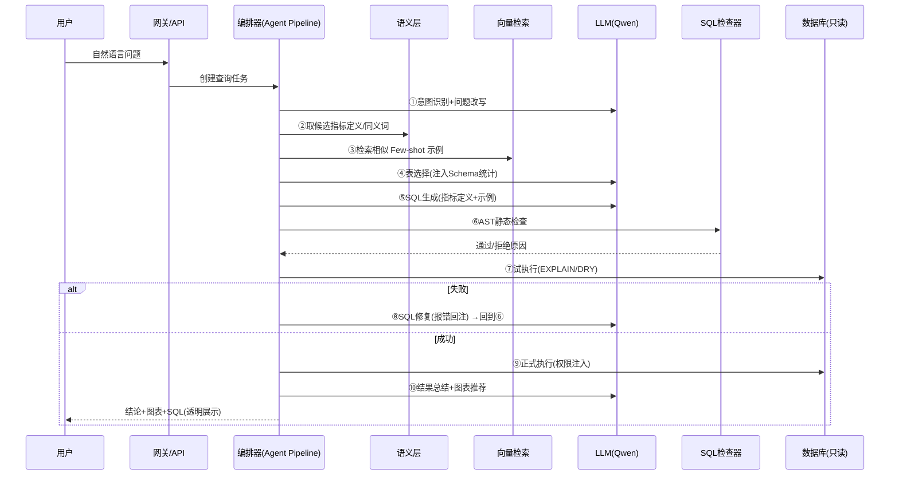

# ChatBI 技术设计文档

| 所属项目 | ChatBI —— 对话式商业智能系统 |
|---|---|
| 文档版本 | v1.0 |
| 编写日期 | 2026-10-22 |
| 上游文档 | [01-项目设计文档](01-项目设计文档.md)、[02-功能设计文档](02-功能设计文档.md) |

---

## 1. 总体架构

### 1.1 架构分层

```
┌─────────────────────────────────────────────────────────────┐
│ 接入层    Web 前端（对话/图表） · 开放 API · 管理后台        │
├─────────────────────────────────────────────────────────────┤
│ 应用层    会话管理 · 反馈采集 · 产物管理 · 审计日志          │
├─────────────────────────────────────────────────────────────┤
│ 编排层    Agent Pipeline（意图识别→改写→表选择→生成→校验     │
│           →修复→执行→总结→图表推荐）· 重试与降级控制         │
├─────────────────────────────────────────────────────────────┤
│ 能力层    语义层(指标/同义词) · Few-shot 检索 · NL2Viz       │
│           · SQL 静态检查(AST) · 权限注入 · 脱敏              │
├─────────────────────────────────────────────────────────────┤
│ 执行层    SQLAlchemy 引擎（只读账号） · 元数据解析(DBParser) │
├─────────────────────────────────────────────────────────────┤
│ 存储层    业务库(MySQL) · 向量库(FAISS/Milvus) · Redis       │
│           · 问答轨迹库 · 评测集库                            │
└─────────────────────────────────────────────────────────────┘
```

### 1.2 核心链路时序



## 2. 技术选型

| 组件 | 选型 | 理由 |
|---|---|---|
| LLM | Qwen 系列（qwen-plus 日常 / qwen-max 复杂） via 阿里云百炼 OpenAI 兼容接口 | 与课程 Demo 一致；分级控制成本；兼容 OpenAI SDK 生态 |
| Agent 框架 | OpenAI Agents SDK（`agents`） | 课程 Demo 已验证；原生支持 Function Calling、多 Agent、Handoff |
| ORM / SQL 工具 | SQLAlchemy 2.x + sqlglot（AST 解析） | SQLAlchemy 做元数据与执行（复用 DBParser）；sqlglot 做 SQL 静态检查与方言改写 |
| 元数据解析 | 自研 DBParser（课程 Demo 扩展） | 已实现表/字段统计（distinct/max/min/mode/nan/random/样例） |
| 向量检索 | V1: FAISS（本地）→ V2: Milvus | Few-shot 示例与指标召回；Embedding 用 text-embedding-v3 |
| 前端 | React + ECharts | 图表渲染成熟，卡片式对话流 |
| 服务端 | FastAPI + async | 流式 SSE 输出，异步编排 |
| 缓存/队列 | Redis | 相同问题缓存、任务状态 |
| 数据源 | V1: SQLite(chinook)/MySQL | 课程与生产同构切换 |

## 3. 核心模块设计

### 3.1 元数据解析模块（DBParser 扩展）

在课程 Demo 的 `DBParser` 基础上扩展：

```python
class DBParser:  # 课程 Demo 已实现
    # 已有：table_names / _table_fields(distinct,mode,nan,max,min,random)
    #       foreign_keys / _table_sample / check_sql / execute_sql

    # —— 扩展点 ——
    def get_schema_prompt(self, table_names: list[str]) -> str:
        """将选中表的 schema+统计+样例序列化为 Prompt 片段（markdown 表格）"""

    def get_relation_prompt(self, table_names: list[str]) -> str:
        """输出选中表之间的外键关系（多表 JOIN 依据）"""

    def refresh(self, table_name: str):
        """元数据增量刷新（表结构变更后调用）"""

    def profile_query_cost(self, sql) -> Cost:
        """EXPLAIN 估算扫描行数，超阈值前置拦截"""
```

**设计要点**：Schema 信息进入 Prompt 的格式固定为 markdown 表格（含字段名/类型/主外键/取值样例/极值/高频值），显著降低字段误用率 —— 该结论来自课程 Demo 中"给样例数据后生成质量明显提升"的观察。

### 3.2 表选择模块（Table Selection Agent）

```python
table_select_agent = Agent(
    name="SQL Table Selector",
    instructions="你是 SQL 专家。根据用户问题与候选表的元数据，选出回答问题所需的表"
                 "（1~3 张，优先少表）。必须只从候选表中选择。",
    model="qwen-plus",
    tools=[parse_table],   # function_tool 包装 DBParser.get_table_fields
)
```

- 输入：用户问题 + 表清单（名称 + 业务注释）；
- 输出：选中表列表 + 选择理由（用于透明展示与调试）；
- 表数量 ≤ 5 时跳过该步，直接全量注入（降低延迟）。

### 3.3 SQL 生成模块（NL2SQL 核心）

**Prompt 结构（模板化组装）**：

```
[角色] 你是资深 SQL 专家，为 {db_type} 编写查询。
[任务] 仅依据给定的表结构，将用户问题翻译为一条 SELECT 语句。

[约束]
1. 只能使用 <表结构> 中出现的表和字段，禁止编造；
2. 命中指标定义时必须原样使用其 calculation 表达式；
3. 只输出一条 SQL，不要解释；引用别名与字段保持一致；
4. 时间条件用 {today} 推算相对日期。

[表结构] {schema_prompt}
[表关系] {relation_prompt}
[指标定义] {metrics_prompt}
[示例] {fewshot_prompt}   ← 向量检索的相似问答对

[对话历史摘要] {history_digest}
[用户问题] {rewritten_question}
```

**Few-shot 检索**：`embedding(question) → top-3 相似 (question, sql)`；示例库来源 = 评测集 + 点踩修正后的正确对（课程 Demo 的 `gt_qes_answer` 生成流程即冷启动方案）。

### 3.4 SQL 校验与自修复模块

**静态检查（sqlglot AST）**：

```python
def static_check(sql: str) -> CheckResult:
    # 1. 解析失败 → 拒绝
    # 2. 语句类型必须为 SELECT（拦截 INSERT/UPDATE/DELETE/DDL）
    # 3. 单语句（拦截 ; 多语句注入）
    # 4. 表名/字段名 ⊆ 本次注入的候选集合（拦截幻觉对象）
    # 5. 禁用函数黑名单（load_file、sleep 等）
    # 6. 无注释注入（/* */ 与 -- 截断攻击）
```

**试执行与自修复**：

```
dry_run: EXPLAIN <sql>            # 结构与权限预检，不扫全表
失败 → RewriteAgent：
    input = 原问题 + 原 SQL + 报错信息(traceback)
    output = 修复后的 SQL
循环 ≤ 3 次（指数退避不需要，串行即可）
```

修复 Prompt（对应课程 Demo 的 rewrite 思路）：

```
你是 SQL 专家。以下 SQL 执行报错，请结合用户意图修复并只输出修复后的 SQL。
用户问题：{question}
原 SQL：{sql}
报错信息：{error}
表结构：{schema_prompt}
```

### 3.5 语义层模块

- **存储**：业务库表 `metric`（名称/口径/calculation/维度/owner/版本）、`metric_synonym`、`metric_table_ref`（血缘）；
- **运行时流程**：问题改写后，用"问题 + 同义词表"做向量 + 关键词双路召回 → 命中指标注入 Prompt → 生成后校验 SQL 中包含 calculation 表达式（防模型擅自改口径）；
- **口径展示**：命中指标随应答返回（`metrics_used` 字段），前端 ⓘ 悬浮显示。

### 3.6 图表推荐模块（NL2Viz）

两阶段：**规则引擎先行，LLM 兜底**：

```python
def recommend_chart(data_profile) -> ChartSpec:
    # 单行单列 → stat_card
    # 类别列+数值列: 类别≤6 且占比语义 → pie; 否则 bar
    # 时间列+数值列 → line
    # 两数值列 → scatter
    # 例外：数据量/类别数超限 → 表格 + 提示
```

- 输出 `ChartSpec`（type/x/y/series/agg/sort/topn），前端 ECharts 渲染；
- 用户"换图表"指令仅改 `ChartSpec`，不重跑 SQL。

### 3.7 结果总结模块（Answer Summary）

```
你是数据分析助手。基于用户问题、执行的 SQL 与查询结果，
用 1~3 句中文给出直接结论（数值带单位，重要的做对比/排序描述），
不要编造结果中不存在的数字。
问题：{question}  SQL：{sql}  结果：{result_markdown}
```

结果序列化为 markdown 表格（课程 Demo 用 `df.to_markdown()` 已验证效果良好）；行数 > 30 时仅将头部 + 统计摘要给 LLM。

### 3.8 多轮对话管理

- **会话状态**（Redis，TTL 24h）：

```json
{
  "session_id": "...",
  "turns": [
    {"q": "改写后的问题", "sql": "...", "tables": ["invoices"],
     "filters": {"year": 2013}, "metric": "销售额", "chart": "line"}
  ],
  "last": {...}
}
```

- **指代消解**：改写 Agent 输入 = 最近 3 轮摘要 + 当前问题，输出完整独立问题；
- **查询修改类指令**（换图/加条件）：正则 + 意图分类前置识别，走轻量 SQL 改写路径（延迟 < 3s）。

### 3.9 权限与安全模块

```
执行前 Pipeline：
  static_check(sql)
    → inject_row_level(sql, user_rules)   # sqlglot 改写 WHERE
    → apply_column_mask(sql, user_rules)  # 脱敏函数包裹
    → readonly_account.execute(sql)
```

- 权限规则与用户身份绑定，从配置中心读取，**模型不可见、不可影响**（防提示词注入）；
- 越权尝试（问题中诱导查询无权限表）→ 返回"无权限"而非报错细节；
- 全链路审计日志：`audit_log(user, question, sql, tables, rows, elapsed, ts)`。

## 4. 数据模型（核心表）

| 表 | 关键字段 | 说明 |
|---|---|---|
| `conversation / message` | 会话、消息、轨迹 JSON | 问答轨迹与审计 |
| `metric / metric_synonym` | 指标定义、同义词 | 语义层 |
| `feedback` | 消息ID、类型(赞/踩)、原因、标注SQL | 反馈闭环 |
| `eval_case` | 问题、标准SQL、标准答案、标签(单表/多表/聚合…) | 评测集 |
| `fewshot_pair` | 问题、SQL、embedding | 示例库 |
| `datasource / meta_cache` | 连接配置、元数据快照 | 数据源管理 |

## 5. 评测体系设计

### 5.1 评测集构建流水线（复用课程 Demo 思路）

```
对每张表 × 每个字段(及组合)：
  LLM 生成问题(question_prompt)
  → LLM 生成 SQL(answer_prompt) → check_sql 校验
  → 执行取标准答案
  → LLM 改写为用户口吻(question_rewrite_prompt)
  → 人工抽检入库 eval_case
```

### 5.2 指标计算

| 指标 | 定义 |
|---|---|
| 执行准确率 | `exec(gen_sql) 结果 == exec(gt_sql) 结果` |
| 结果准确率 | LLM-as-judge 比较自然语言答案与标准答案数值 |
| 意图准确率 | 意图分类正确率（取数/修改/澄清…） |
| 安全拦截率 | 注入/越权用例拦截比例（要求 100%） |

### 5.3 回归机制

- 评测脚本 CI 化：Prompt/模型/参数 PR 触发自动回归，输出对比报告（准确率变化、失败 case diff）；
- 版本基线：每个上线版本锁定评测报告快照。

## 6. 性能与成本优化

| 手段 | 说明 |
|---|---|
| 模型分级 | 表选择/意图/改写/总结 → qwen-plus；SQL 生成/修复 → qwen-max |
| 结果缓存 | 相同(问题指纹+数据版本+权限组)直接复用，Redis TTL 10min |
| 流式输出 | 意图通过后即返回"正在查询"，总结 SSE 流式 |
| Prompt 瘦身 | 只注入选中表 schema；历史摘要压缩至 300 token |
| 预算护栏 | EXPLAIN 扫描行数 > 阈值（如 1000 万）前置拒绝并引导加条件 |

## 7. 部署架构

```
                    ┌────────────┐
   用户/浏览器 ────►│  Nginx/网关 │
                    └─────┬──────┘
             ┌────────────┼────────────┐
        ┌────▼─────┐ ┌────▼─────┐ ┌────▼──────┐
        │ 前端静态  │ │ FastAPI  │ │ 管理后台   │
        └──────────┘ │ ×N(无状态)│ └───────────┘
                     └────┬─────┘
        ┌──────────┬──────┼───────┬───────────┐
   ┌────▼───┐ ┌────▼───┐ ┌▼─────┐ ┌▼─────────┐ ┌▼────────┐
   │ Redis  │ │ MySQL  │ │ Milvus│ │ 业务DB(只读)│ │ 百炼LLM │
   └────────┘ └────────┘ └──────┘ └───────────┘ └─────────┘
```

- FastAPI 多副本无状态水平扩展；LLM 调用走百炼兼容接口（API Key 环境变量注入，禁止硬编码 —— 课程 Demo 中 Key 明文写入 notebook 的问题在生产中必须避免）；
- 可观测：请求级 trace（问题→各阶段耗时→token 消耗）接入 Prometheus + 日志平台。

## 8. 目录结构（工程组织建议）

```
chatbi/
├── app/                  # FastAPI 服务
│   ├── api/              # 路由：问答、会话、反馈、管理
│   ├── agent/            # 编排 Pipeline 与各 Agent
│   ├── core/             # LLM 客户端、配置、权限
│   └── models/           # ORM 模型
├── chatbi_core/          # 可复用核心包
│   ├── dbparser.py       # 元数据解析（课程 Demo 扩展）
│   ├── semantic/         # 语义层
│   ├── sqlgen/           # 生成/校验/修复
│   ├── viz/              # 图表推荐
│   └── security/         # 静态检查、权限注入、脱敏
├── evals/                # 评测集与回归脚本
├── prompts/              # Prompt 模板（版本化管理）
└── web/                  # 前端
```

## 9. 关键设计决策记录（ADR 摘要）

| # | 决策 | 备选 | 理由 |
|---|---|---|---|
| 1 | SQL 生成走"约束式单次生成+修复"而非 Agent 自由多轮 | ReAct 自由探索 | 可控、可测、延迟低；自由探索留给 Data Agent |
| 2 | 权限在执行层注入而非 Prompt 约束 | Prompt 声明权限 | 防 prompt injection；模型错误不导致越权 |
| 3 | 图表推荐规则引擎优先 | 全 LLM 判断 | 确定性、零成本；LLM 处理规则覆盖不了的边角 |
| 4 | Few-shot 走向量检索而非全量塞入 | 全量示例 | 控制上下文长度与成本 |
| 5 | 复用 OpenAI Agents SDK 的 function_tool | 自研工具调用 | 与课程技术栈一致，团队学习成本低 |
