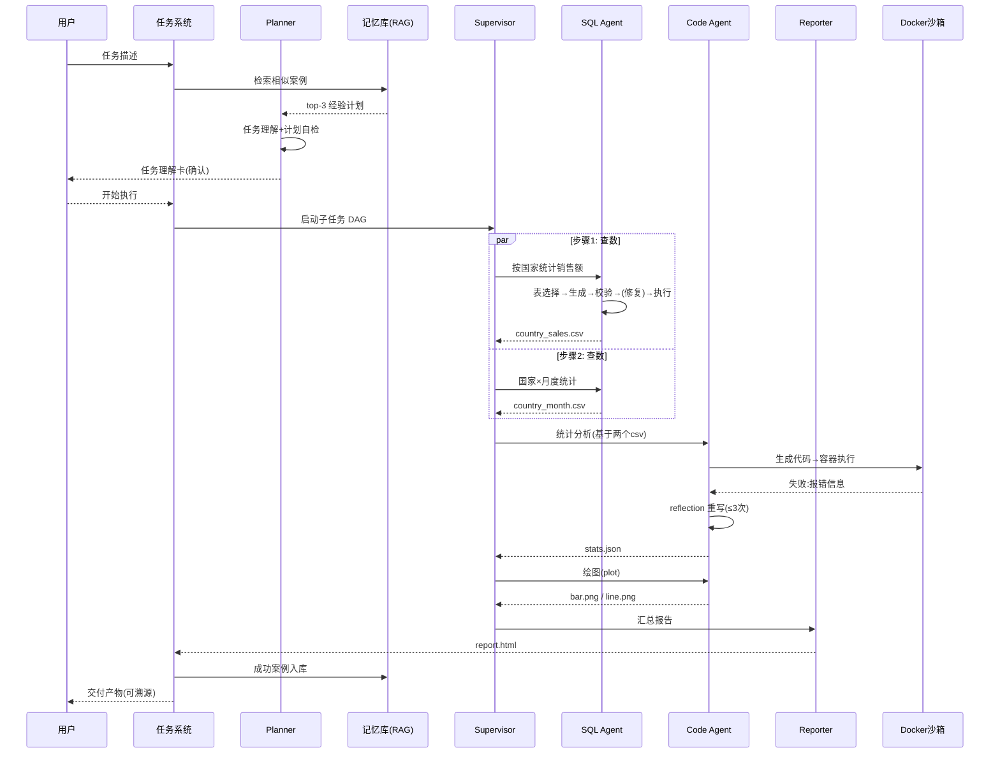

# Data Agent 技术设计文档

| 所属项目 | Data Agent —— 数据任务自主智能体 |
|---|---|
| 文档版本 | v1.0 |
| 编写日期 | 2026-10-22 |
| 上游文档 | [01-项目设计文档](01-项目设计文档.md)、[02-功能设计文档](02-功能设计文档.md) |

---

## 1. 总体架构

### 1.1 架构分层

```
┌────────────────────────────────────────────────────────────────┐
│ 接入层    任务对话前端 · 执行时间线 · 产物中心 · 管理后台 · API   │
├────────────────────────────────────────────────────────────────┤
│ 任务层    任务队列 · 状态机 · 人工确认卡点 · 预算熔断 · 通知      │
├────────────────────────────────────────────────────────────────┤
│ 编排层    Planner(规划) · Supervisor(调度/分派) · Reflector(反思) │
│           SQL Agent · Code Agent · Analyst Agent · Reporter      │
├────────────────────────────────────────────────────────────────┤
│ 能力层    工具注册中心(function_tool) · 语义层(共享ChatBI)        │
│           · SQL安全检查 · 记忆/经验库(RAG) · ChartSpec           │
├────────────────────────────────────────────────────────────────┤
│ 执行层    SQLAlchemy 只读引擎 · Docker 沙箱池 · 绘图服务          │
├────────────────────────────────────────────────────────────────┤
│ 存储层    业务库(MySQL) · 向量库(Milvus/FAISS) · Redis           │
│           · 对象存储(产物/数据快照) · 审计日志                    │
└────────────────────────────────────────────────────────────────┘
```

### 1.2 端到端任务时序（V2 多 Agent 形态）



## 2. 技术选型

| 组件 | 选型 | 理由 |
|---|---|---|
| LLM | Qwen：Planner/Reflector/Reporter 用 qwen-max；SQL/Code 常规执行用 qwen-plus | 复杂推理与成本平衡（分级） |
| Agent 框架 | OpenAI Agents SDK：`Agent` + `function_tool` + Handoff/Runner | 课程 Demo 同栈；多 Agent 原生支持 |
| 沙箱 | Docker（一次性容器）+ resource limits | 安全隔离；镜像预置 numpy/pandas/matplotlib/sklearn/sqlalchemy |
| SQL 工具 | SQLAlchemy + sqlglot（AST 检查） | 与 ChatBI 共享 DBParser 与安全模块 |
| 任务系统 | Celery / 自研队列 + 状态机 | 长任务异步、可恢复 |
| 向量库 | FAISS → Milvus | 经验案例检索 |
| 对象存储 | MinIO / S3 兼容 | 产物与数据快照 |
| 服务端 | FastAPI + async + SSE | 前端时间线实时推送 |
| 部署 | K8s（沙箱池 K8s Job / 独立节点池） | 沙箱与主服务隔离部署 |

## 3. 核心模块设计

### 3.1 Planner（规划器）

```python
planner_agent = Agent(
    name="Data Task Planner",
    instructions=PLANNER_PROMPT,   # 见 §6
    model="qwen-max",
    output_type=TaskPlan,          # 结构化输出: 子任务DAG
    tools=[list_tables, parse_table, get_relations],
)
```

- **输入组装**：任务描述 + 表清单（名称+业务注释）+ top-3 相似经验案例 + 附件清单；
- **输出**：`TaskPlan`（结构化 DAG，见功能文档 F5），经校验器检查（无环、预算内、产物齐备）后落库；
- **重规划**：Reflector 触发时，携带"已完成步骤 + 失败原因 + 剩余目标"增量重规划，已完成产物不重做。

### 3.2 Supervisor（调度器）

- 维护任务状态机：`pending → running(step_i/N) → waiting_confirm → done/failed/cancelled`；
- 依赖调度：DAG 中无依赖节点并行派发（并发度 ≤3）；每个子任务派给对应 Agent；
- 确认卡点：子任务标记 `requires_confirm` 时挂起，通知用户，确认后继续；
- 预算控制：全局计数器（步数/token/时长），超限熔断。

### 3.3 SQL Agent（子任务执行者）

复用 ChatBI 的 SQL 管线（表选择 → 生成 → 静态检查 → 试执行 → 修复 → 执行），以 Agent 形态封装：

```python
@function_tool
def execute_sql(sql: Annotated[str, "A single read-only SELECT statement"]) -> str:
    """Execute SQL against the read-only data source. Returns markdown rows
    (truncated to 50 rows; full result saved to workspace file if larger)."""

@function_tool
def parse_table(table_name: Annotated[str, "Table name"]) -> str:
    """Return schema/statistics/sample of the given table."""   # 课程 Demo 同款
```

- 大结果集策略：>50 行只回传 markdown 预览 + 完整数据写入工作区文件，返回文件路径（控制上下文长度）；
- 权限：工具内部按当前用户注入行/列级规则（与 ChatBI 同一安全模块，模型不可绕过）。

### 3.4 Code Agent（代码解释器）

对应课程 Code Agent Demo 的生产化实现：

```python
class CodeAgent:
    """planer → code_gen → sandbox execute → reflection → summary"""
    def __init__(self):
        self._plan_prompt     = "...规划本步骤需要哪些步骤与函数，不输出代码..."
        self._code_gen_prompt = "...写出完整python代码(含import)，数据从工作区读取，图表存 artifacts/..."
        self._reflect_prompt  = "...执行报错:{error}，请修复以下代码...\n```python\n{code}\n```"
        self.retry_limit = 3

    def run(self, subtask, workspace) -> StepResult:
        thought = self.llm(self._plan_prompt.format(task=subtask))
        code = self.extract_code(self.llm(self._code_gen_prompt(...)))
        for _ in range(self.retry_limit):
            ok, output, err = sandbox.run(code, workspace)
            if ok: return StepResult(ok=True, output=summary(output))
            code = self.extract_code(self.llm(
                self._reflect_prompt.format(error=err, code=code)))
        return StepResult(ok=False, error=err)
```

**沙箱执行设计**：

```python
def sandbox_run(code: str, workspace_dir: str, limits) -> ExecResult:
    # 1. 静态扫描：拦截 os.system / subprocess / socket / eval 等
    # 2. 一次性容器：
    #    docker run --rm --network none
    #      --memory 2g --cpus 1 --pids-limit 128
    #      -v workspace:/workspace:rw
    #      -v code.py:/task/code.py:ro
    #      sandbox-image python /task/code.py --timeout 120
    # 3. 回收：stdout/stderr(截断)、exit code、artifacts/ 目录 diff、资源用量
```

- **工作区**：任务级目录（对象存储挂载），任务结束归档；数据快照（查询结果文件）记录 schema 与行数供溯源；
- **包管理**：预置常用包白名单；需要额外包时在镜像版本迭代中评估加入（不支持运行时 pip，防供应链风险）。

### 3.5 Analyst / Reporter Agent

- **Analyst**：对中间产物做统计加工（占比/同比/贡献度/异常检测），产出结构化结论（JSON：结论句 + 支撑数据点），供报告引用；
- **Reporter**：按报告模板把"结论 JSON + 图表 + 数据表"组装为 md/html；**数字一致性校验**——报告文本中出现的每个数字必须能在产物数据中找到（抽取比对），不一致则打回重写；
- 报告模板存于配置中心（章节结构、公司 VI），模板变量由 Reporter 填充。

### 3.6 记忆模块（经验库）

- **写入**：任务成功后，抽取（任务描述、计划 DAG、关键代码、用表、产物类型）→ embedding 入库；用户点踩/标记问题的案例下线；
- **读取**：Planner 规划前检索 top-3（embedding 相似度 + 用表重合度加权），注入 Prompt 为"参考案例"；
- **防退化**：复用案例的任务仍走完整的执行与校验（经验只影响规划，不影响校验强度）。

### 3.7 工具注册中心

```python
TOOL_REGISTRY = {
    "metadata": [list_tables, parse_table, get_relations],
    "query":    [check_sql, execute_sql],
    "compute":  [run_code],
    "viz":      [plot],
    "file":     [read_file, write_file, list_artifacts],
}
# 注册规范：name / description / input_schema / side_effect_level
# side_effect_level: read(自动执行) | export(轻确认) | write(确认) | dangerous(强确认)
```

- 工具描述即 Agent 的"能力说明书"，新工具注册后 Planner 无需改代码即可感知；
- 所有工具调用记录（入参、出参摘要、耗时、确认人）进入审计日志。

## 4. 数据模型（核心表）

| 表 | 关键字段 | 说明 |
|---|---|---|
| `task` | 任务描述、状态、计划DAG、预算、耗时、token | 任务主表 |
| `task_step` | 任务ID、步骤ID、类型、状态、输入输出、重试次数、确认记录 | 步骤明细 |
| `artifact` | 任务ID、类型、对象存储Key、溯源(step_id/数据快照ID) | 产物 |
| `memory_case` | 任务描述、计划、关键代码、embedding、状态 | 经验库 |
| `sandbox_log` | 任务ID、容器ID、资源用量、退出码 | 沙箱审计 |
| `audit_log` | 用户、动作(工具/确认/干预)、详情、时间 | 全链路审计 |

## 5. 与 ChatBI 的共享底座

| 共享模块 | 说明 |
|---|---|
| DBParser 元数据解析 | 同一包（`chatbi_core.dbparser`），双方复用 |
| SQL 安全模块 | static_check / 权限注入 / 脱敏，同一实现 |
| 语义层 | 指标口径一处定义，双方引用 |
| ChartSpec 图表规范 | 出图风格统一 |
| 评测基建 | 评测框架复用，各自维护评测集 |

工程上以 monorepo 组织：`packages/core`（共享）+ `apps/chatbi` + `apps/data-agent`。

## 6. Prompt 设计（关键模板）

**Planner**

```
你是数据任务规划专家。将用户任务拆解为子任务 DAG，要求：
1. 步骤类型只能是 query / code / plot / report / tool，共 {max_steps} 步以内；
2. 每步给出：目标、类型、依赖的步骤、预期产物文件名；
3. 数据获取优先 query(SQL)；统计/建模/批量处理用 code；呈现用 plot/report；
4. 参考以下类似任务的成功计划（可调整参数复用）：{fewshot_plans}
5. 只输出 JSON。

可用表：{table_list}
用户任务：{task}
```

**Code 生成（Code Agent）**

```
你是 Python 数据处理专家。为子任务编写完整可执行代码：
1. 只使用工作区已有数据文件（清单：{workspace_files}），新产物写到 artifacts/；
2. 必须包含所需 import；禁止网络访问、subprocess、os.system；
3. 图表用 matplotlib，关闭交互模式，savefig 到 artifacts/；
4. 代码末尾 print 关键结果摘要（≤20 行）。
子任务：{subtask}
表结构（如需查库）：{schema_prompt}
```

**Reflection（自修复，课程 Demo 同型）**

```
上述代码执行失败，报错信息：
{error}
请在原代码基础上最小化修改修复。先输出修复说明一行，再输出完整代码（```python```）。
```

**Reporter**

```
你是数据分析报告撰写专家。基于结构化结论与图表清单撰写报告（模板：{template}）：
1. 所有数字必须来自提供的结论 JSON，禁止编造或推算；
2. 每个数据结论后标注来源标记，如 [数据:country_sales]；
3. 语言：中文，结论先行，图表引用按编号。
```

## 7. 安全设计

| 层 | 措施 |
|---|---|
| 代码执行 | 一次性 Docker 容器：`--network none`、CPU/内存/PID/时长限额、只读代码挂载、运行时静态扫描黑名单 |
| SQL | 只读账号 + AST 白名单检查 + 权限注入（继承 ChatBI 三道防线） |
| 提示注入 | 工具返回内容标记为数据（不作为指令）；数据文件中的可疑指令不改变计划（工具层无"执行指令"能力） |
| 高危操作 | side_effect 分级 → 人工确认卡；确认记录入审计 |
| 数据出域 | 导出/外发需确认；产物水印含任务/用户标识 |
| 密钥管理 | LLM Key 等一律环境变量/KMS 注入，禁止写入代码与 notebook（课程 Demo 的明文 Key 写法仅限教学） |

## 8. 评测体系

| 评测集 | 组织形式 | 指标 |
|---|---|---|
| 任务级 | 任务描述 + 预期产物清单 + 关键数值断言 | 端到端成功率、产物合格率 |
| 子任务级 | SQL 准确率（复用 ChatBI 评测）；代码一次通过率 | 步骤成功率、平均重试次数 |
| 安全级 | 注入/越权/危险代码用例 | 拦截率 100%（一票否决） |
| 成本级 | — | 单任务平均 token / 时长 / 容器开销 |

- 产物合格率判定：数值断言（必须精确）+ LLM-as-judge（结构与完整性）双评；
- 回归机制与 ChatBI 一致：Prompt/模型/工具变更触发 CI 回归。

## 9. 部署架构

```
                 ┌──────────────┐
  用户 ────────► │  网关 / 前端  │
                 └──────┬───────┘
            ┌───────────┼─────────────┐
       ┌────▼─────┐ ┌───▼────┐  ┌─────▼─────┐
       │ 任务 API  │ │ 编排服务 │  │ 管理后台   │
       │ (FastAPI) │ │(Planner/│  └───────────┘
       └────┬─────┘ │Supervisor)│
            │       └───┬────┘
       ┌────▼───────────┼──────────────┐
  ┌────▼────┐ ┌─────────▼────────┐ ┌───▼─────┐
  │ MySQL/  │ │  Agent Workers    │ │ Redis   │
  │ Milvus  │ │ (SQL/Code/Report) │ │ 队列/状态│
  └─────────┘ └─────────┬─────────┘ └─────────┘
                        │ 沙箱调用
              ┌─────────▼──────────┐   ┌──────────┐
              │ Docker 沙箱池       │   │ MinIO    │
              │ (独立节点/无网络)    │   │ 产物存储  │
              └────────────────────┘   └──────────┘
                        │ LLM
                   ┌────▼─────┐
                   │ 百炼 API  │ (qwen-max / qwen-plus)
                   └──────────┘
```

- 沙箱池独立节点部署（故障隔离 + 资源隔离），容器用完即毁；
- Agent Workers 无状态水平扩展；任务状态与断点在 Redis/MySQL，支持服务重启后续跑。

## 10. 目录结构（工程组织建议）

```
repo/
├── packages/core/            # 与 ChatBI 共享
│   ├── dbparser.py           # 元数据解析
│   ├── sql_security/         # 静态检查/权限注入
│   ├── semantic/             # 语义层
│   └── viz/                  # ChartSpec
├── apps/data-agent/
│   ├── orchestrator/         # Planner / Supervisor / Reflector
│   ├── agents/               # sql_agent / code_agent / analyst / reporter
│   ├── tools/                # 工具注册中心与各工具实现
│   ├── sandbox/              # Docker 沙箱封装、静态扫描
│   ├── memory/               # 经验库读写
│   ├── api/                  # 任务 API (FastAPI)
│   └── prompts/              # Prompt 模板（版本化）
├── apps/chatbi/              # 姊妹项目
└── evals/                    # 评测集与回归（按 app 分目录）
```

## 11. 关键设计决策记录（ADR 摘要）

| # | 决策 | 备选 | 理由 |
|---|---|---|---|
| 1 | 代码在 Docker 一次性容器执行，而非进程内 exec | 课程 Demo 的 `exec` | 隔离与资源限额是生产前提（Demo 注释亦指出该方向） |
| 2 | V1 单 Agent + 工具，V2 再拆多 Agent | 一步到位多 Agent | 先验证任务闭环，多 Agent 的收益在并行与专业化，属于优化项 |
| 3 | 经验库只影响规划、不影响校验 | 全链路复用 | 防止错误案例被复用放大 |
| 4 | 报告数字强制回链校验 | 仅靠 Prompt 约束 | 杜绝报告幻觉的最后防线 |
| 5 | 沙箱禁网络、预置白名单包 | 运行时 pip | 供应链安全与确定性 |
| 6 | SQL 子任务直接复用 ChatBI 管线 | 重写 | 一处优化两处受益，口径与安全一致 |
