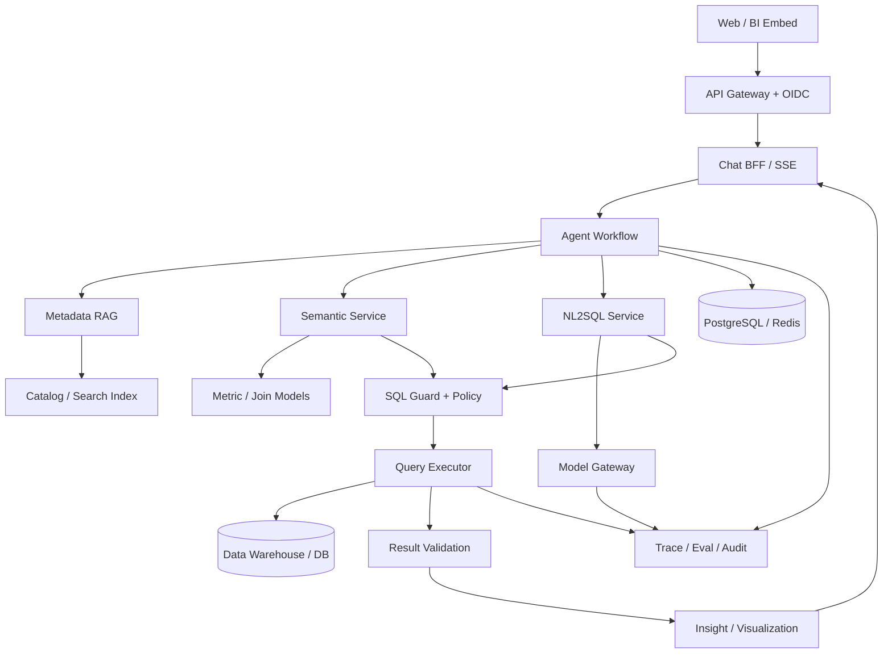
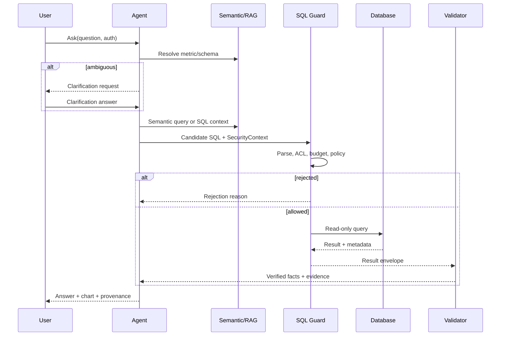
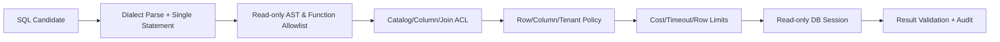
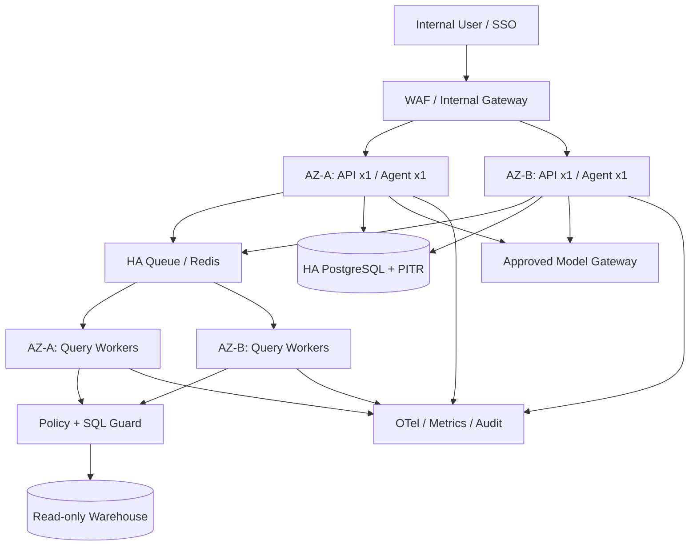

# ChatBI / Data Agent 技术设计文档（TDD）

**版本：** V1.0（生产实施设计基线）  
**状态：** 生产参考实施版；待架构/安全/数据/SRE 联合签收  
**关联：** 01《项目设计文档》CAP 编号；02《功能设计文档》FR/TC 编号  
**架构假设：** 企业内部、一个主数据仓库优先、只读分析、Python 服务栈、可复用现有身份和指标体系；具体选型以环境盘点为准。

## 1. 技术目标与关键决策

| ADR 编号 | 决策 | 原因 | 待验证条件 |
|---|---|---|---|
| ADR-01 | 语义查询优先，NL2SQL 兜底 | 降低指标口径和 Join 幻觉 | 现有指标覆盖率与语义 API |
| ADR-02 | Agent 只负责规划与调用，安全策略由代码/数据源强制 | 模型输出不属于可信边界 | 源端 RLS/CLS 和身份透传 |
| ADR-03 | MVP 只读，不执行任意代码或外部 Action | 降低副作用与攻击面 | 数据源只读账号与数据库方言 |
| ADR-04 | 状态化 Workflow + 有界重试 | 可恢复、可观测、避免无限循环 | Checkpoint 和取消语义 |
| ADR-05 | 数据留在源端，平台只存元数据/最小必要结果 | 数据最小化、降低同步成本 | 性能、审计与缓存策略 |
| ADR-06 | 从第一天建立 Golden Set 和 Trace | 模型/语义变化可回归 | 数据快照与业务标注资源 |
| ADR-07 | 模型、语义层、检索与查询引擎均通过接口解耦 | 避免早期厂商锁定 | 团队能力与实际供应商 |

**信任边界：** 用户自然语言、检索文档、模型输出、SQL 候选、MCP 工具响应都视为不可信输入；只有通过身份验证、策略引擎和数据库权限校验后，才能访问业务数据。

## 2. 总体逻辑架构



### 2.1 模块职责与契约

| 模块 ID | 服务 | 输入 | 输出 | 安全/失败边界 |
|---|---|---|---|---|
| TECH-AGENT | Agent Orchestrator | UserRequest + SecurityContext | TaskState/Events | 步数、时长、调用上限 |
| TECH-RAG | Metadata Retrieval | Query + ACL filter | RankedMetadata | 无权元数据不进入 Prompt |
| TECH-SEM | Semantic Service | SemanticQuery | CompiledQuery | 指标版本与 Join Path 校验 |
| TECH-SQL | NL2SQL Service | Question + AllowedSchema | SQLCandidate | 候选 SQL 不能直接执行 |
| TECH-SEC | SQL Guard/Policy | Candidate + SecurityContext | ValidatedQuery/Reject | fail-closed、权限与资源限制 |
| TECH-EXEC | Query Executor | ValidatedQuery | QueryResult | 只读凭据、超时、取消 |
| TECH-RESULT | Result Validator | QueryResult + QueryContext | Evidence/Facts | 数据质量、单位与范围 |
| TECH-VIZ | Visualization | Facts + ResultSchema | ChartSpec | 仅引用已验证数值 |
| TECH-EVAL | Eval Service | Trace + Golden Set | EvalRecord | 版本化、数据快照 |
| TECH-OPS | Observability/Audit | Events | Metrics/Logs/Audit | 敏感数据最小化 |
| TECH-CONN | Connector Gateway | DataSourceConfig | Connection/Metadata | Secret Manager、只读权限 |

**部署建议：** MVP 可先采用一个模块化 Python 后端加独立查询 Worker，而不是一开始拆十余个微服务；上述模块是逻辑边界，后续按负载、权限和团队边界拆分。

### 2.2 V1/V2 扩展模块（暂不进入 MVP 主链路）

| 模块 ID | 对应功能 | 技术职责 | 安全与验收前置条件 |
|---|---|---|---|
| TECH-INSIGHT | FR-014 | 确定性异常统计、贡献度分解、证据约束解释 | 区分贡献与因果，数值可复算 |
| TECH-REPORT | FR-015 | 报告模板、引用、审批、订阅与发送队列 | 收件人权限复核、审计与撤回策略 |
| TECH-FILE | FR-016 | 文件校验、隔离解析、临时数据集与生命周期 | 病毒/恶意内容检查、敏感字段处理 |
| TECH-FED | FR-017 | 多源查询规划、联邦执行、跨源血缘 | 源端权限、成本上限与数据驻留 |
| TECH-ACTION | FR-018 | 工具注册、白名单、人工审批、幂等执行 | 默认禁用；独立威胁建模和审批审计 |

这些模块的名称与功能文档保持一一对应；技术实施时应在独立设计评审后再确定接口、数据契约和容量方案。


## 3. 主请求时序与 Agent 状态机



### 3.1 任务状态

| 状态 | 触发条件 | 下一状态 | 持久化内容 |
|---|---|---|---|
| RECEIVED | 接收到有效请求 | AUTHORIZED | request_id、用户与租户 |
| AUTHORIZED | 身份/配额通过 | RETRIEVING | SecurityContext 引用 |
| RETRIEVING | Schema/指标检索完成 | CLARIFYING 或 PLANNING | 检索版本与候选 |
| CLARIFYING | 语义歧义 | RETRIEVING 或 CANCELLED | 待澄清问题和选择 |
| PLANNING | 路由与计划完成 | GENERATING | 任务计划、预算 |
| GENERATING | 语义编译或 NL2SQL | VALIDATING | SQL 候选、方言 |
| VALIDATING | Guard 通过 | EXECUTING | ValidatedQuery 引用 |
| EXECUTING | 查询成功 | VERIFYING | query_id、统计信息 |
| VERIFYING | 结果校验完成 | RENDERING | Facts、Evidence |
| RENDERING | 生成回答/图表 | COMPLETED | Answer、ChartSpec |
| FAILED | 任意节点不可恢复错误 | 终态 | 错误码、可重试性 |
| CANCELLED | 用户取消或预算超限 | 终态 | 取消原因、资源释放 |

**恢复语义：** Checkpoint 不保存明文凭据；恢复前重新校验当前身份和权限；对已执行的查询使用 `query_id` 去重，不因 Agent 恢复重复触发昂贵查询。重试只针对安全的幂等操作，超时查询先取消再决定是否重试。

### 3.2 有界执行预算

默认建议 `max_steps=12、max_llm_calls=6、max_sql_repair=2、max_execution_seconds=120`；各值是待压测配置项。每个请求携带总时限和剩余预算，子工具不得自行放宽。用户取消时传播 cancellation token 到执行器，数据库查询句柄需要支持取消或连接终止。

## 4. 核心数据契约

### 4.1 安全上下文

```json
{
  "request_id": "req_123",
  "user_id": "user_42",
  "tenant_id": "tenant_a",
  "roles": ["analyst"],
  "groups": ["east_sales"],
  "allowed_dataset_ids": ["sales_orders"],
  "policy_version": "policy_2026_10",
  "auth_subject": "oidc-subject-reference"
}
```

`SecurityContext` 必须由可信认证中间件生成，**不能**来自用户消息、Prompt 或 Agent 自行修改。数据源凭据不放在该对象中；执行器通过短期身份/受控凭据引用获取连接。

### 4.2 语义查询契约

```json
{
  "semantic_model_version": "v3",
  "metrics": ["paid_gmv"],
  "dimensions": ["order_date", "province"],
  "time_range": {
    "start_inclusive": "2026-09-27T00:00:00+08:00",
    "end_exclusive": "2026-10-27T00:00:00+08:00",
    "timezone": "Asia/Shanghai"
  },
  "filters": [{"field": "region", "op": "eq", "value": "east"}],
  "limit": 500
}
```

时间采用**左闭右开**区间，明确时区和粒度，避免 `BETWEEN` 造成边界重复。`paid_gmv` 是示例指标 ID，并非当前企业已存在的指标。

### 4.3 通过校验的查询契约

```json
{
  "query_id": "qry_123",
  "datasource_id": "dw_sales",
  "dialect": "postgres",
  "sql": "SELECT order_date, SUM(paid_amount) AS gmv FROM approved_sales_view WHERE order_date >= :start AND order_date < :end GROUP BY order_date",
  "parameters": {"start": "2026-09-27", "end": "2026-10-27"},
  "validated_object_ids": ["approved_sales_view"],
  "policy_version": "policy_2026_10",
  "semantic_model_version": "v3",
  "execution_limits": {"timeout_seconds": 30, "max_rows": 10000},
  "validation_digest": "sha256-of-canonical-query-and-context"
}
```

`ValidatedQuery` 由 Guard 签发或通过受信任服务间调用传递，执行器必须验证其来源、有效期、身份、策略版本和内容完整性；**不得**允许客户端直接提交伪造的 `validation_digest` 绕过检查。

### 4.4 结果与证据契约

```json
{
  "query_id": "qry_123",
  "columns": [{"name": "order_date", "type": "date"}, {"name": "gmv", "type": "decimal", "unit": "CNY"}],
  "rows": [],
  "row_count": 0,
  "is_truncated": false,
  "data_as_of": "2026-10-27T00:00:00+08:00",
  "evidence": {
    "datasource_id": "dw_sales",
    "metric_ids": ["paid_gmv"],
    "semantic_model_version": "v3",
    "filters": [],
    "sql_query_id": "qry_123"
  },
  "warnings": ["NO_MATCHING_ROWS"]
}
```

空结果与数值 0 不同；`is_truncated=true` 时不能据返回的前 N 行推断全量排名、总和或占比。

## 5. 语义层与指标治理（TECH-SEM）

### 5.1 最小实体模型

| 实体 | 必要字段 | 约束 |
|---|---|---|
| Dataset | id、datasource、physical_object、owner、classification | 唯一映射与授权 |
| Metric | id、name、expression、aggregation、time_dimension、owner、version | 已发布版本不可静默改写 |
| Dimension | id、dataset、column/expression、type、grain | 粒度与单位一致 |
| Entity | id、primary_key、dataset | 主键和基数可验证 |
| JoinRelationship | left/right entity、keys、cardinality、allowed_path | 禁止未经治理的扇出 Join |
| BusinessTerm | term、synonyms、domain、metric_ref | 同名多义需可澄清 |
| PolicyBinding | object、subject_scope、row_filter、column_mask | 与源端策略对齐 |

### 5.2 语义编译流程

`业务问句 → 指标/维度匹配 → 选择已发布语义版本 → 检查维度兼容性和 Join 基数 → 注入时间与权限约束 → 编译方言 SQL → Guard → 执行`。

对于比率指标，先定义分子/分母的聚合粒度再求比率，避免对日比率简单求平均。对去重用户数、货币、退款、订单状态、时区和自然周/财务月做显式建模。

**失败策略：** 指标冲突、Join 歧义、跨粒度不可比、缺少时区或必要维度时优先澄清或拒绝，不能降级到“模型自由猜测业务口径”。

## 6. 元数据检索与 RAG（TECH-RAG）

**索引对象：** 允许访问的表/字段、指标定义、业务术语、样例 SQL、文档片段和血缘；每条索引记录必须带 `tenant_id、dataset_id、classification、acl_tags、source_version、updated_at`。

**检索链路：** Query Rewrite → ACL/域过滤 → 关键词/BM25 与向量召回 → 合并去重 → 重排 → 上下文预算裁剪 → 引用追踪。用户无权访问的 Schema 不得进入召回结果、Embedding 查询结果或模型上下文。

**索引失效：** 元数据变更触发增量重建；指标废弃/权限收回需优先撤销访问，不能等批量夜间同步。多租户向量检索必须验证过滤实际生效，避免“先全局 TopK 再客户端过滤”造成泄漏或召回偏差。

**技术候选：** 小规模优先 PostgreSQL + pgvector；复杂混合检索可评估 Qdrant。是否迁移以 Recall@K、ACL 过滤性能和运维成本为依据。

## 7. NL2SQL 生成与结果正确性（TECH-SQL）

### 7.1 生成路径

`问题规范化 → 授权 Schema Linking → 指标/样例检索 → 目标方言 SQL 生成 → 静态校验 → 安全门 → 数据库验证 → 有限修复 → 结果核验`。

优先生成参数化 SQL；无法参数化的对象名必须来自授权白名单并进行方言安全转义。LLM 的自报置信度不等于统计校准概率；不应把 `0.91` 当作真实正确率向用户承诺。

### 7.2 失败分类

| 类型 | 例子 | 处理 |
|---|---|---|
| Schema Linking 错误 | 选错同名订单表 | 重检索、澄清领域 |
| 业务语义错误 | GMV 误用订单金额 | 回退已治理指标/拒绝 |
| SQL 语法错误 | 方言函数不支持 | 有限修复 |
| SQL 逻辑错误 | 错误 Join 导致重复计数 | Join 基数校验与结果测试 |
| 权限错误 | 使用无权字段 | 直接拒绝，不能自动提权 |
| 资源超限 | 全表扫描过大 | 缩小范围、限额或拒绝 |
| 数据质量问题 | 数据延迟、缺失 | 结果标警告或拒绝结论 |

## 8. SQL Guard 与源端执行安全（TECH-SEC / TECH-EXEC）

### 8.1 强制检查流水线



**禁止：** INSERT、UPDATE、DELETE、MERGE、CREATE、ALTER、DROP、TRUNCATE、CALL、COPY/UNLOAD、跨外部系统写入、动态 SQL、可产生副作用的函数/存储过程、未授权系统表、多语句、任意 Python/脚本执行。

**只允许 SELECT 仍不够安全。** 部分数据库可通过 `SELECT` 调用有副作用的函数、访问外部表或写入目标对象；`EXPLAIN ANALYZE` 也可能真正执行查询。因此需采用方言专用白名单、函数/对象检查、数据库只读权限和资源配额的多重防线。`EXPLAIN` 只由服务端在受控模式生成，不直接执行用户任意解释语句。

### 8.2 执行边界

- 数据库账号只读、最小权限；支持时启用只读事务和数据库级 statement timeout。
- 优先透传最终用户身份到数据仓库；如必须使用共享服务身份，需有数据库/语义层**不可绕过**的 RLS/CLS 与租户策略。无法证明策略强制生效时拒绝上线。
- 查询运行在受控连接池和资源组，设置行数、扫描量、并发、执行时长与返回字节上限。
- 执行器只接收 Guard 已批准且未过期的查询；策略变更后重新校验。
- SQL、参数、源端对象和结果引用写入审计，但敏感值默认脱敏或最小化记录。
- 结果缓存的键必须包含用户/租户/策略版本/语义版本/参数/数据新鲜度；未经验证不得跨用户共享。

### 8.3 Guard 伪代码（非可直接部署实现）

```python
# Pseudocode: parser rules are dialect-specific and must be security-tested.
def validate_and_execute(candidate, context):
    require_authenticated_context(context)
    statements = parse_all(candidate.sql, dialect=candidate.dialect)
    require_exactly_one_statement(statements)
    require_readonly_ast_and_safe_functions(statements[0])
    require_authorized_catalog_and_columns(statements[0], context)
    require_row_column_tenant_policy(context)
    require_query_budget(statements[0], context)
    validated = sign_short_lived_query(candidate, context)
    return execute_with_readonly_credentials(validated, context)
```

SQLGlot 可用于 AST 解析和遍历，但不能仅凭“解析成功”认定 SQL 安全或执行正确；最终必须依赖方言适配、源端权限与集成/红队测试。

## 9. API、事件流与错误契约

### 9.1 外部 API（建议）

| 方法与路径 | 用途 | 关键控制 |
|---|---|---|
| POST /v1/sessions | 新建会话 | 认证、配额 |
| POST /v1/sessions/{id}/messages | 提问并启动任务 | 幂等键、SSE |
| GET /v1/sessions/{id} | 会话历史 | 会话所有权 |
| POST /v1/query/{id}/cancel | 取消查询 | 发起人/授权管理员 |
| POST /v1/metadata/search | 授权元数据检索 | ACL filter |
| GET /v1/metrics/{id} | 指标定义 | 域与指标权限 |
| POST /v1/semantic/query | 语义查询 | 模型版本/对象策略 |
| POST /v1/sql/validate | SQL 预校验 | 不代表授权执行 |
| POST /v1/query/execute | 受控查询 | Guard 令牌/服务间鉴权 |
| POST /v1/evaluations/runs | 离线评测 | 评测管理员权限 |
| GET /v1/audit/events | 审计查询 | 审计角色、脱敏 |

**重要调整：** 原稿同时把 `POST /v1/query/execute` 和 `POST /v1/sql/generate` 写成公开 API。生产实现应明确：原始 SQL 生成和查询执行属于受控内部能力；若暴露给外部客户，也必须经同一 Guard/权限门槛，不得形成旁路。

### 9.2 SSE 事件示例

```json
{"event":"task.progress","data":{"request_id":"req_123","state":"RETRIEVING","message":"正在匹配指标"}}
{"event":"task.clarification","data":{"request_id":"req_123","question":"请选择销售额口径","options":["paid_gmv","order_amount"]}}
{"event":"task.completed","data":{"request_id":"req_123","query_id":"qry_123","answer":"...","evidence":{},"chart":{}}}
```

SSE 事件需带序列号与任务 ID，客户端断线重连后不得重复执行查询。鉴权失败、权限拒绝、数据源故障和查询超时使用统一错误码 `DA-4010、DA-4031、DA-5032、DA-5041` 等，并区分可重试性。

## 10. 数据存储、缓存与血缘

| 存储/系统 | 保存内容 | 关键约束 |
|---|---|---|
| PostgreSQL | 用户配置、会话元数据、语义模型、评测索引 | 多租户隔离、加密、备份 |
| Redis | 临时状态、幂等键、限流、短期缓存 | TTL、敏感值最小化 |
| Vector Index | 元数据/文档/样例 SQL Embedding | ACL、版本、撤权失效 |
| Object Storage | 附件、评测样本、Trace 归档 | 分类分级、加密、生命周期 |
| Data Warehouse | 原始业务事实数据 | 源端权限、只读资源组 |
| Trace/Metric Backend | Span、指标、错误分类 | 脱敏、保留期、访问审计 |

**默认不复制业务事实数据。** 若为性能缓存结果，需明确缓存有效期、访问隔离、删除/撤权联动和审计。对每条回答保存 `query_id → metric_version → datasource/object → filters → result_digest` 的最小血缘链。

## 11. 模型网关、编排框架与技术选型

| 层 | MVP 候选 | 选型理由 | 何时升级 |
|---|---|---|---|
| API | FastAPI | Python 生态、类型契约清晰 | 企业已有 Java 统一网关时复用 |
| Agent | LangGraph | 状态图、Checkpoint、可中断工作流 | 强 .NET 体系评估 Microsoft Agent Framework |
| Model Gateway | LiteLLM/企业网关 | 路由、限流、故障切换 | 合规和 SLA 要求更高时增强 |
| Semantic | 现有 BI/指标平台优先 | 避免重复定义口径 | 无现有能力时评估 MetricFlow/Cube/SuperSonic |
| SQL AST | SQLGlot + 方言专用规则 | 可解析/遍历/方言适配 | 高风险数据库需原生 Parser 补强 |
| Metadata DB | PostgreSQL | 事务与治理配置统一 | 依现有基础设施替换 |
| Vector | pgvector | 初期简单 | 复杂混合检索评估 Qdrant |
| Query Engine | 主仓库直连 | 源端权限简单 | 多源联邦再评估 Trino |
| Observability | OpenTelemetry + Prometheus/Grafana | Trace/Metric 标准化 | 规模增长后接企业 APM |
| Deployment | Docker + Kubernetes（按需） | 可扩缩容和发布回滚 | PoC 可先单机/VM |
| Private LLM | vLLM（按需） | 私有化模型服务候选 | 大规模分布式再评估 Ray Serve |

**取舍：** 不因为“Agent 平台化”而提前引入 Trino、Qdrant、Ray、微调训练和复杂多 Agent 协作。先以评测证明瓶颈，再做分层扩容。原稿涉及的具体厂商功能与版本需在技术定型时重新核验官方文档。

## 12. 可靠性、性能与降级

### 12.1 非功能目标（待压测）

| 指标 | MVP 建议 | 观测点 |
|---|---:|---|
| 简单问数端到端 P95 | ≤15 秒 | API 接收到答案完成 |
| 复杂分析端到端 P95 | ≤40 秒 | 独立复杂任务集 |
| SQL 语法有效率 | ≥97% | 方言校验成功 |
| Golden Set 结果正确率 | ≥85% | 执行结果等价 |
| 核心指标结果正确率 | ≥95% | P0 指标子集 |
| 生产可用性目标 | 99.9%（建议起点） | 需明确排除计划维护和源端故障口径 |
| 安全回归 | 100% 高风险用例通过 | 越权、注入、危险 SQL、资源耗尽 |

### 12.2 故障矩阵

| 故障 | 策略 | 不可突破的边界 |
|---|---|---|
| LLM 429/5xx | 指数退避、熔断、同合规域模型切换 | 不得跨越数据驻留限制 |
| 向量服务故障 | 授权关键词检索降级 | 不得取消 ACL |
| 数据库超时 | 取消查询、缩小范围 | 不得无限重试 |
| Agent 节点异常 | Checkpoint 恢复 | 恢复前重新鉴权 |
| SQL 校验失败 | 有限修复或拒绝 | 不得绕过 Guard |
| 观测后端故障 | 缓冲非关键指标 | 关键安全审计按策略决定是否阻断 |
| Redis 故障 | 降级或暂停依赖状态的任务 | 不得丢失关键幂等/权限状态 |

### 12.3 容量估算

容量规划至少采集：`峰值请求/秒、活跃会话、每问模型调用次数、输入/输出 Token、平均查询扫描字节、数据仓库队列时间、平均结果字节、P95 延迟、缓存命中率`。生产扩容依据真实压测，不直接以“几十并发”推导节点数。

## 13. 观测、评测与发布流水线

### 13.1 Trace 与指标

统一 `trace_id、request_id、session_id、query_id、user/tenant pseudonymous id、model_id、prompt_version、workflow_version、semantic_version、retrieval_config、golden_set_version`。Span 覆盖身份、检索、规划、SQL 生成、Guard、查询、结果核验和渲染。

关键指标：`agent_duration_seconds、llm_input_tokens、llm_output_tokens、sql_guard_block_total、query_duration_seconds、query_scan_bytes、retrieval_recall_at_k、answer_feedback_score、cost_per_answer`。

Prompt、工具参数、查询结果可能包含敏感信息；默认只采集摘要、长度、对象 ID 和脱敏字段，完整载荷需专项审批与保留期。

### 13.2 Golden Set 与回归

| 样本层 | 核心评价 | 示例 |
|---|---|---|
| 基础问数 | 结果等价、SQL 语法、延迟 | 单指标、时间趋势 |
| 复杂分析 | Join 正确、聚合粒度、资源成本 | 多表、窗口函数、同环比 |
| 语义陷阱 | 指标/时间/去重口径 | 同名 GMV、退款口径 |
| 多轮 | 上下文继承与重置 | “其中华东呢” |
| 安全红队 | 未授权访问、危险 SQL、Prompt Injection | 跨租户、DML、敏感字段 |
| 可靠性 | 失败恢复、超时、取消、降级 | 模型 429、DB 超时 |

SQL 不以文本 Exact Match 为唯一标准；可执行问题采用**结果等价性**，并对时间、顺序、浮点容差、NULL、权限和数据快照明确判定规则。任何模型、Prompt、语义、检索或工作流变更都需跑相同冻结集。

### 13.3 CI/CD Gate

`Lint/Type Check → Unit Test → Guard Security Tests → Integration Tests → Offline Golden Set → 性能/成本比较 → 安全扫描 → Staging → Canary → Production`。

发布拒绝条件包括：高风险安全用例失败、核心指标正确率下降超出容忍度、不可解释的跨租户数据暴露、P95 或单问成本超过已批准预算、缺少回滚策略。

## 14. 安全威胁与合规设计

| 威胁 | 攻击面 | 控制措施 | 验证 |
|---|---|---|---|
| Prompt Injection | 用户消息、文档、检索结果 | 指令/数据隔离、工具白名单、独立策略层 | 红队集 |
| 敏感信息泄漏 | Prompt、模型响应、Trace、Embedding | 数据分类、脱敏、最小化留存、ACL | DLP/权限测试 |
| Excessive Agency | Agent 自主工具调用 | 只读默认、审批、预算、无副作用工具 | 越权与审批测试 |
| SQL 注入/危险函数 | 生成 SQL、方言扩展 | AST+方言规则+源端只读权限 | SQL 红队 |
| 多租户串读 | 缓存、检索、会话、查询执行 | 租户隔离键、策略版本、源端 RLS | 交叉租户测试 |
| 资源耗尽 | 大查询、循环规划、模型重试 | 扫描/Token/步骤/并发/时间上限 | 压测与故障注入 |
| 供应链与工具风险 | 模型、MCP、插件 | 版本锁定、工具签名/审核、出站限制 | 依赖扫描 |

中国境内的个人信息、数据安全、跨境与公众生成式 AI 服务义务需由法务结合实际场景判断。内部工具与公众服务不应直接套用同一合规结论。此文档不构成法律意见。

## 15. 部署拓扑、备份与运维

**PoC：** API/Agent 进程 + PostgreSQL/pgvector + Redis（可选）+ 直连只读仓库；最少运维组件。  
**MVP：** API 与 Query Worker 分离；模型网关；Secrets Manager；独立评测/观测；CI/CD 和预发布环境。  
**生产：** 按压测引入 K8s/HPA、HA 数据库、队列、灾备、细粒度网络策略、资源组和多模型冗余。

运维 Runbook 至少覆盖：模型不可用、查询超时/取消、权限策略变更、指标发布回滚、数据源凭据轮换、索引撤权失效、Golden Set 回退、数据泄漏事件处置。

**备份恢复：** 备份语义模型、权限配置、会话元数据和评测集；不默认复制原始业务事实。定义 RPO/RTO 并定期演练，当前原稿未提供目标数值，本版第26章设定 RPO/RTO 生产参考值，需恢复演练验证。

## 16. 技术验证计划与开放问题

| 验证项 | 验证方法 | 通过条件 |
|---|---|---|
| 语义模型可复用 | 接入真实核心指标 | 业务专家签收口径，查询可重现 |
| 用户权限透传 | 用两种角色/两租户运行相同问题 | 返回结果严格按授权隔离 |
| SQL Guard 方言安全 | 多语句、CTE DML、函数、系统表、EXPLAIN 变体测试 | 高风险用例全部拒绝 |
| 数据库资源控制 | 大扫描、慢查询、并发压测 | 查询预算生效且可取消 |
| Agent 状态恢复 | 模型/DB 中断与重连 | 无重复危险调用、状态可追踪 |
| 结果证据链 | 抽查回答→指标版本→SQL→源数据 | 事实性结论可追溯 |
| 模型网关合规 | 主/备模型切换测试 | 不跨越已批准的数据驻留边界 |
| 评测回归 | 更换 Prompt/模型/语义版本 | 指标差异可解释且有发布 Gate |

**仍待确认：** 数据仓库及 SQL 方言、现有语义层能力、IAM/SSO 机制、RLS/CLS 强制位置、数据驻留与模型供应商、并发/延迟基线、日志留存和 RPO/RTO。

## 17. 参考资料与版本核验

原始研究稿提及的技术参考包括 LangGraph、Microsoft Agent Framework、dbt MetricFlow、Cube、SuperSonic、SQLGlot、pgvector、Qdrant、Trino、vLLM、OpenTelemetry、OpenLineage、OWASP GenAI Top 10、BIRD 与 Spider 2.0。**原稿研究会话引用不作为正式文献；本版第30章补充官方文档 URL 与核对日期，技术定型前仍需锁定适用版本。**

**本版新增工程化要求：** 明确任务状态机、身份与查询数据契约、方言/函数安全边界、源端权限、查询取消/幂等、缓存隔离、可追溯证据、评测发布 Gate。以上属于设计建议，需通过目标环境的 PoC、压测和安全测试验证。

## 18. 生产参考拓扑与基础设施参数

本技术设计采用 `BASE-2026-10`：企业内部、单区域双可用区、一个主数仓、200 注册用户、1,000 问题/工作日、峰值 1 QPS、30 个在途 Agent、12 个并行 SQL 查询。数值是容量设计假设，必须由真实流量压测替换。



| 组件 | 生产初始规格 | 关键保障 |
|---|---|---|
| API/BFF | 2 副本，分布两可用区，独立 HPA | 无状态、探针、优雅终止、限流 |
| Agent Worker | 2 副本，最多 30 在途任务 | 持久化 checkpoint、超时、幂等 |
| Query Worker | 2 副本，每副本最多 6 活跃查询 | 独立队列、DB 连接池、可取消 |
| PostgreSQL | 托管 HA、PITR、加密、备份 30 天 | RPO 15 分钟 / RTO 60 分钟目标 |
| Redis/Queue | 托管 HA，任务事件与缓存分离命名空间 | 队列有界、持久状态不只存 Redis |
| 模型网关 | 主备均在批准区域；每租户预算 | 429/5xx 退避、熔断、成本追踪 |
| 元数据检索 | PostgreSQL + pgvector 起步 | ACL 前置过滤、撤权失效 |
| 可观测 | OTel Collector + Metrics + 审计存储 | Trace 脱敏、指标告警、审计防篡改 |
| 数据仓库 | 源端只读身份/安全视图/资源组 | 不允许直连生产 OLTP 主库做重查询 |

**网络分区：** 入口层只能访问 API；Agent 可访问模型网关和内部能力服务；Query Worker 才可访问受控数仓地址；模型服务不得直连数仓；数据库出站默认拒绝。密钥通过工作负载身份获取，禁止注入镜像、代码仓库和用户可读日志。

## 19. 身份、权限与数据隔离的强制实施方案

### 19.1 三层鉴权

1. **入口身份：** OIDC 验证 `iss/aud/exp/nonce`（按实际登录流程适用）；从可信身份提供者映射 `tenant_id、subject、groups`，后端忽略用户请求体里的同名字段。
2. **发现授权：** Catalog、指标、字段、示例 SQL 和 Embedding 检索都按租户与用户 ACL 过滤；过滤必须发生在召回结果进入 Prompt 之前。
3. **执行授权：** SQL Guard 检查表/列/函数/策略；真正执行必须由数仓用户代理身份、数据库 RLS/CLS、受控安全视图或等效的强制机制保证。**应用层 where 拼接不是敏感数据的唯一安全屏障。**

**决策树：** 能源端按用户身份授权 → 采用委托凭据；无法委托但可由源端强制隔离租户 → 使用每租户独立只读角色与安全视图；两者均无法证明隔离 → 该敏感数据集不上线。所有策略缓存必须包含 `policy_version`，撤权事件强制清除相关缓存和会话可执行上下文。

### 19.2 防跨租户泄漏清单

| 入口 | 强制隔离键 | 不可接受的实现 |
|---|---|---|
| 会话/消息 | tenant_id + user_id + session_id | 只按 session_id 查询 |
| 元数据/RAG | tenant_id + ACL + policy_version | 向量检索后再让 LLM 判断权限 |
| 结果缓存 | tenant_id + principal + policy_version + query_hash + data_version | 仅按 SQL 文本作为缓存键 |
| 任务/事件 | tenant_id + task_id + owner_id | SSE event_id 可跨用户复用 |
| 数据库连接 | delegated identity / tenant-scoped DB role | 共享高权限账号 + Prompt 限制 |
| 审计与 Trace | tenant_id + request_id + restricted role | 让普通管理员浏览原始结果 |

## 20. SQL Guard 的生产强制策略与绕过防护

SQLGlot 可以解析目标方言 AST，但官方明确其解析器较宽松、并非数据库有效性或安全性证明。因此 **AST 是第一道筛选，不是最终安全边界**。本模块实施 `deny-by-default + 数据库最小权限 + 运行时预算`。

### 20.1 强制校验顺序

`固定目标方言 → 单语句解析 → 根节点仅 SELECT/安全 WITH → 递归拒绝 DDL/DML/CALL/INTO/多语句/危险 EXPLAIN → 引用对象解析 → 只允许已治理 schema/view/column → 函数与 UDF allowlist → 权限策略 → 参数绑定 → 计划成本估算 → 源端只读会话 → 执行与审计`。

**边界案例必须覆盖：** CTE 中写操作、存储过程/外部函数、COPY/UNLOAD/EXPORT、SELECT INTO、系统表、信息模式、文件读取、网络访问函数、跨 catalog、注释与编码混淆、SQL 方言特有语法、权限提升函数、递归 CTE 资源耗尽。仅允许 SELECT 并不足以防止这些问题。

### 20.2 查询预算

| 控制项 | 初始阈值 | 强制层 |
|---|---:|---|
| 单任务 Agent 步数 | ≤12 | Orchestrator |
| 单任务 LLM 调用 | ≤6 | Model Gateway |
| SQL 修复次数 | ≤2 | Orchestrator |
| SQL 同时执行 | 每用户 3、每租户 12 | Scheduler + DB 资源组 |
| SQL 排队 | 最多 100 个任务；等待 ≤30 秒 | Queue |
| 预览行数 | 500 | Executor/Result Service |
| 最大返回行数 | 10,000（V1 导出另审） | DB/Result Service |
| 简单查询执行超时 | 30 秒 | DB session + Worker |
| 复杂查询执行超时 | 90 秒 | DB session + Worker |
| 单任务总时限 | 120 秒 | Orchestrator |
| 扫描成本 | 按引擎 bytes/credits 上限配置 | EXPLAIN + 引擎资源组 |

**重要限制：** EXPLAIN 的估算可能缺失或不准，无法独立作为硬成本边界；必须叠加数仓资源组、扫描/CPU 限额、并发、超时、结果上限。SQL 修复不得因为第一次权限拒绝而尝试换表、换身份或绕过策略。

### 20.3 生产安全门伪代码

```python
# Architecture pseudocode; adapter-specific rules need integration tests.
def authorize_and_execute(candidate, ctx, catalog, policy, db):
    assert ctx.verified_by_gateway
    assert candidate.dialect == catalog.dialect
    ast = parse_exactly_one(candidate.sql, dialect=candidate.dialect)
    reject_mutation_or_unsafe_constructs(ast)
    objects = resolve_objects_and_columns(ast, catalog)
    assert objects <= catalog.allowed_objects(ctx)
    reject_unapproved_functions(ast, catalog.function_allowlist)
    decision = policy.authorize(ctx, objects, candidate.parameters)
    if not decision.allow:
        raise AccessDenied()
    plan = db.explain_with_restricted_identity(ast, ctx)
    enforce_estimated_budget_or_reject(plan, ctx)
    with db.read_only_session(identity=ctx.delegated_identity) as session:
        session.set_query_timeout(ctx.query_timeout)
        session.set_resource_group(ctx.resource_group)
        return session.execute_bound(ast, candidate.parameters)
```

该伪代码仅说明**控制点与信任边界**，不是可直接复制上线的 Guard 实现。每个 SQL 方言都必须做专用解析/函数/视图/连接器红队测试；数据库源端的只读与行列策略不可省略。

## 21. API、SSE、幂等与任务生命周期（生产契约）

### 21.1 关键端点

| 方法与路径 | 用途 | 权限/幂等 | 返回 |
|---|---|---|---|
| POST /v1/sessions | 创建会话 | 登录用户；client_request_id 可选 | 201 + session_id |
| POST /v1/sessions/{id}/messages | 提交问数 | 只允许会话所有者；必带 Idempotency-Key | 202 + task_id |
| GET /v1/tasks/{task_id} | 查询状态/结果 | owner 或受控审计角色 | 200 + task state |
| GET /v1/tasks/{task_id}/events | SSE 事件流 | owner；支持 Last-Event-ID | text/event-stream |
| POST /v1/tasks/{task_id}/cancel | 取消查询 | owner；幂等 | 202 + cancel_requested |
| GET /v1/metrics/{metric_id} | 指标详情 | 数据集/指标 ACL | 200 + metric_version |
| POST /v1/admin/semantic/publish | 发布指标 | 语义管理员 + 审批 | 202 + change_id |
| GET /v1/audit/events | 审计检索 | 专门审计权限 | 分页、脱敏 |

### 21.2 请求与任务示例

```json
{
  "session_id": "sess_01",
  "client_request_id": "req-client-01",
  "message": "最近30天支付GMV按日趋势",
  "domain_id": "sales",
  "locale": "zh-CN",
  "time_zone": "Asia/Shanghai"
}
```

`POST` 头包含 `Authorization: Bearer ...` 与 `Idempotency-Key`。服务端只使用验证后的身份，不相信请求体自带的 `user_id/tenant_id`。相同租户、用户、幂等键、请求体指纹在 24 小时内返回同一 `task_id`；相同键不同请求体返回 409 `IDEMPOTENCY_CONFLICT`。

```json
{
  "task_id": "task_01",
  "status": "QUEUED",
  "request_id": "req_server_01",
  "poll_url": "/v1/tasks/task_01",
  "events_url": "/v1/tasks/task_01/events"
}
```

### 21.3 SSE 与状态恢复

```text
id: 11
event: retrieving
data: {"task_id":"task_01","stage":"metadata"}

id: 12
event: querying
data: {"task_id":"task_01","query_id":"query_01"}

id: 13
event: completed
data: {"task_id":"task_01","result_ref":"result_01"}
```

事件 `id` 在任务范围内单调递增；客户端通过 `Last-Event-ID` 续读。心跳、断线重连、客户端取消与后端状态持久化分离；SSE 连接断开**不等于**任务取消。任务恢复时重新验证权限与语义版本，不能复用已撤销权限的 checkpoint。

**任务状态补充：** `QUEUED、RETRIEVING、CLARIFYING、GENERATING、VALIDATING、EXECUTING、VERIFYING、RENDERING、COMPLETED、FAILED、CANCEL_REQUESTED、CANCELLED、EXPIRED`。任何终态不得再次进入 EXECUTING；重试生成新的 attempt_id，query_id 作为执行幂等与审计主键。

## 22. 数据库模型、索引与数据生命周期

### 22.1 最小逻辑实体

| 实体 | 主键/关键字段 | 保留/索引策略 |
|---|---|---|
| session | session_id、tenant_id、owner_id、status、expires_at | tenant+owner+updated_at 索引；90 天 |
| message | message_id、session_id、role、content_ref | session+created_at 索引；敏感内容可加密 |
| agent_task | task_id、session_id、idempotency_key、request_hash、status、version | tenant+owner+idempotency_key 唯一约束 |
| task_event | task_id、seq、event_type、payload_ref | (task_id, seq) 唯一；支持 SSE 续传 |
| semantic_metric | metric_id、version、owner、definition、status | (metric_id, version) 唯一；发布不可原地改写 |
| query_audit | query_id、task_id、principal、policy_version、sql_hash、status | 只存必要参数摘要；180 天安全审计 |
| eval_run | eval_id、golden_version、model_version、semantic_version、score | 冻结快照、可重跑 |
| datasource | source_id、tenant_id、secret_ref、classification | 不存明文凭据；权限过滤 |

### 22.2 核心约束示例（PostgreSQL 元数据存储）

```sql
CREATE TABLE agent_task (
  task_id UUID PRIMARY KEY,
  tenant_id TEXT NOT NULL,
  owner_id TEXT NOT NULL,
  session_id UUID NOT NULL,
  idempotency_key TEXT NOT NULL,
  request_hash TEXT NOT NULL,
  status TEXT NOT NULL,
  semantic_version TEXT,
  policy_version TEXT NOT NULL,
  created_at TIMESTAMPTZ NOT NULL DEFAULT now(),
  updated_at TIMESTAMPTZ NOT NULL DEFAULT now(),
  UNIQUE (tenant_id, owner_id, idempotency_key)
);
CREATE INDEX idx_task_owner_created
  ON agent_task (tenant_id, owner_id, created_at DESC);
```

这是**逻辑示例**，并未包含全部 FK、RLS、加密、分区和迁移策略；实际数据库 schema 必须用 Alembic 等迁移工具管理并通过 DDL 审核。元数据库应用账号本身也须按读写职责拆分，不能与业务数仓连接混用。

### 22.3 缓存与撤权

结果缓存键包含 `tenant_id、principal_id、policy_version、semantic_version、data_version、canonical_query_hash`，TTL ≤5 分钟。敏感数据不落共享 Redis 明文缓存；策略变更时广播失效，无法确认失效时关闭缓存读取。缓存命中也必须重新校验请求身份和当前授权。跨用户共享缓存只有在结果已证明公开且采用单独数据分类审批后才能开启。

## 23. 数据水位、语义版本与结果证据链

### 23.1 水位契约

每个 DataSet 维护 `source_watermark、last_ingested_at、freshness_sla、quality_status、schema_version`。回答中的“数据截至”使用 `source_watermark`，不能使用当前系统时间。过期数据允许在非关键场景按用户确认查看；经营 KPI 和自动化报告在水位不达标时默认阻断发布。

### 23.2 结果契约（扩展）

```json
{
  "query_id": "query_01",
  "metric_id": "paid_gmv",
  "metric_version": "3.2.0",
  "data_as_of": "2026-10-26T23:59:59+08:00",
  "time_zone": "Asia/Shanghai",
  "row_count": 30,
  "is_truncated": false,
  "quality_status": "PASS",
  "evidence": {
    "source_ids": ["sales_dw"],
    "query_hash": "sha256:...",
    "policy_version": "policy_2026_10"
  }
}
```

统计计算在确定性代码中执行。数值结论必须可从 `query_id + 数据快照 + metric_version + 计算规则` 复算；模型输出仅负责组织解释，不得覆盖计算结果。任何字段敏感级别升级或数据质量失败时，结果服务必须阻断对应结论输出。

## 24. 模型网关与 Prompt/工具安全

| 风险面 | 生产强制控制 | 失败时策略 |
|---|---|---|
| 模型出域 | 模型 allowlist、区域标签、DLP、供应商合同审查 | 未批准区域无 fallback，直接降级或拒绝 |
| Prompt Injection | 用户/文档/工具结果标为不可信数据；工具参数由代码校验 | 不执行高风险工具 |
| Tool output | 结构化 schema 校验、长度上限、拒绝隐藏指令 | 丢弃不合法结果并记录 |
| 上下文泄漏 | 仅检索有权元数据，结果样本默认不进 Prompt | 无授权元数据时拒答 |
| Token/成本耗尽 | max_steps/max_calls/TPM/RPM/租户配额 | 限流、熔断、降级 |
| 供应商不可用 | 主备路由、健康检查、指数退避 | 备份仍须满足数据驻留和保密级别 |

**Prompt/模型版本管理：** 每次发布记录 `prompt_hash、model_id、temperature、tool_schema_version、retrieval_config、semantic_version、policy_version`；离线回归比较正确率、拒答率、敏感泄漏、时延与成本。Prompt 更新属于生产变更，不能绕开评测流程。

## 25. 评测数据集、质量门禁与回归算法

**Golden Set 生产结构：** 300 条业务题（基础问数 120、复杂 SQL 60、多轮 45、语义陷阱 45、时效/质量 30）+ 100 条独立安全题。每条业务题标注 `question、expected_metric_ids、allowed_dataset、reference_result、time_zone、data_snapshot、user_policy、difficulty`；安全题标注预期拒绝/脱敏行为。

| 维度 | 计算口径 | 上线阈值 |
|---|---|---|
| Execution Accuracy | 业务题中结果与冻结参考结果等价的比例 | ≥90% |
| 核心指标正确率 | 30 个已治理指标对应样本的结果一致率 | ≥98% |
| 多轮解析正确率 | 45 条多轮样本中上下文继承正确比例 | ≥90% |
| 安全红队通过率 | 100 条攻击/越权/资源测试中符合预期比例 | 100% |
| 数据可追溯率 | 有事实结论的回答中能定位 query/metric/data_as_of 的比例 | ≥99% |
| 任务成功率 | 合法且有授权数据任务成功完成的比例 | ≥98% |
| 性能 | 1 QPS 峰值、30 在途任务时的 P95 | 简单 ≤15 秒、复杂 ≤45 秒 |

**判定细则：** SQL 字符串不必相同；排序只有在问题要求时纳入结果等价；浮点按预先标注的绝对/相对容差比较；NULL 与 0 不等价；时间区间必须一致；权限上下文不同不可共用参考结果。冻结数据快照与语义版本是复现前提。发布前比较上一生产版本，关键指标正确率不得下降，安全回归必须全通过；任何明显退化都阻断灰度。

## 26. 监控告警、SLO 与事件响应

### 26.1 监控四张看板

| 看板 | 核心指标 | 告警示例 |
|---|---|---|
| 可用性 | API 成功率、P95、SSE 首事件、队列积压 | 5 分钟错误率 >2%、P95 持续超限 |
| 数据安全 | policy deny、跨租户拒绝、敏感输出、SQL Guard block | 任一确认越权或危险 SQL 逃逸立即 SEV-1 |
| AI 质量 | Golden Set、有效回答率、语义版本、SQL 修复率 | 核心指标正确率回退、幻觉率上升 |
| 成本与容量 | tokens/answer、模型费用、scan bytes、worker active | 预算 70%/90%/100%、队列接近上限 |

OTel GenAI 属性中消息和工具参数可能包含 PII；默认只采集耗时、Token、模型 ID、工具名称、错误类型、hash 化引用，不采集完整 Prompt、SQL 参数和结果行。仅在审批的故障复现流程中限时启用脱敏采样，并记录审计。

### 26.2 可靠性与灾备

API/Worker 跨两个可用区部署；PostgreSQL HA + PITR，目标 RPO ≤15 分钟、RTO ≤60 分钟；每天检查备份可恢复性、每季度演练跨可用区故障与 PITR。Redis 故障不得造成已完成任务和权限状态丢失；任务持久状态以数据库为准。恢复后必须检查租户隔离、指标版本和队列去重，再恢复查询服务。

**故障处置：** 模型 429 → 限定次数退避/同区域 fallback；模型区域不可用 → 安全降级；数仓慢查询 → 取消并释放资源；策略服务不可用 → fail closed；语义模型回归 → 回滚指标版本；泄漏怀疑 → 冻结数据源和相关会话、保全审计并通知安全负责人。

## 27. CI/CD、环境隔离与回滚 Runbook

**环境：** DEV 只使用合成或脱敏数据；STAGING 使用隔离快照和测试租户；PROD 使用独立身份、Secret、网络和数据库资源。严禁复制生产敏感数据到研发环境。所有部署产物签名、依赖锁定并进行漏洞扫描。

**发布流水线：** 代码检查 → 单元测试 → SQL Guard 方言红队 → 数据库/权限集成测试 → 300+100 Golden Set → 1 QPS/30 并发压测 → 安全扫描 → 预发验收 → 5% 灰度 → 20% 灰度 → 全量。回滚对象包括镜像、Prompt、模型路由、语义模型和检索索引；禁止仅回滚代码而留下不兼容语义版本。

| Runbook | 自动检测 | 第一动作 | 恢复验证 |
|---|---|---|---|
| RB-01 模型异常 | 429/5xx、延迟、失败率 | 熔断/同区域主备切换 | Golden Set 烟测、Token 成本 |
| RB-02 数据源故障 | 连接错误、查询超时 | 暂停该数据源新任务、取消慢查询 | 只读权限、时效、查询成功率 |
| RB-03 语义口径错误 | 指标对账差异、用户反馈 | 冻结指标发布、回滚版本 | 30 个核心指标对账 |
| RB-04 权限事故 | 异常访问审计、DLP 告警 | 禁用受影响工具/数据集、保全证据 | 两用户两租户隔离红队 |
| RB-05 队列积压 | queue depth、等待超时 | 限流、扩 Worker、拒绝高成本任务 | 无重复查询、任务恢复 |
| RB-06 缓存撤权失败 | 旧策略版本缓存命中 | 关闭结果缓存、清除相关键 | 撤权后读不到旧结果 |
| RB-07 AZ 故障 | 副本不可用、数据库 failover | 切换健康 AZ、停止发布 | RPO/RTO、查询幂等、权限复验 |

## 28. 威胁建模与安全验收（2026 更新）

依据 OWASP GenAI LLM Top 10 **2026 版**进行威胁审查，保留原稿 2025 版风险控制并补充 Agent 工具边界。重点不在术语排名，而在实际攻击链：恶意检索文档诱导 Agent 选错工具 → SQL/函数绕过 → 数据泄露；或通过大量复杂问题耗尽 Token/数据库资源。所有安全用例必须同时覆盖模型层、Guard 层、数据库权限和日志/缓存层。

| 威胁链 | 防护组合 | 红队证据 |
|---|---|---|
| Prompt/检索内容注入 | 不可信上下文隔离、工具白名单、独立策略 | TC-003/012/025 |
| 数据越权与间接泄漏 | ACL 前置、源端 RLS/CLS、结果/缓存隔离 | TC-002/027/028/029 |
| SQL 方言/危险函数绕过 | AST+对象/函数 allowlist+DB 只读角色 | TC-025/026 |
| 成本耗尽/循环执行 | Agent/SQL/Token/并发硬预算 | TC-024/030/048 |
| 数据过期与错误归因 | watermark、质量门禁、可复算事实 | TC-041/046/050 |
| 审计篡改或敏感日志 | 分权、加密、防篡改、默认不记原始内容 | TC-039 |

**强制阻塞项：** 任何已知跨租户泄漏、无权数据访问、危险 SQL 逃逸、未批准模型出域、无法撤销的结果缓存、缺失审计链路，都不得进入生产 Pilot。

## 29. 技术验收、接口责任与跨文档映射

| 技术域 | 负责人角色 | 验收产物 | 对应功能与测试 |
|---|---|---|---|
| TECH-AGENT | Agent Tech Lead | 状态机、Checkpoint、取消/幂等 | FR-005/006/020/023；TC-014/018/042—044 |
| TECH-SEM | Analytics Engineer | 30 指标、语义版本、对账报告 | FR-003/007/026；TC-008/010/021 |
| TECH-RAG | Data/AI Engineer | 元数据 ACL、检索回归 | FR-004；TC-011—013 |
| TECH-SQL | AI Engineer | SQL 方言评测、有限修复 | FR-008；TC-022—024 |
| TECH-SEC | Security/DBA | 源端权限、SQL Guard、红队 | FR-001/009/022；TC-002/025—028/045 |
| TECH-EXEC | Backend/Data Engineer | 只读执行、超时、取消、配额 | FR-009/020/024；TC-030/044/048 |
| TECH-RESULT | Backend/Analytics | 证据链、水位、数据质量 | FR-010/019/026；TC-031/041/046/050 |
| TECH-OPS | SRE | SLO、审计、备份、灰度、回滚 | FR-013/023/025；TC-039/047/049 |
| TECH-EVAL | QA/Eval | 300+100 冻结集、CI Gate | FR-012；TC-037/038/040 |
| TECH-EXPORT（V1） | Backend/Security | 导出审批、限额、撤权 | FR-021；V1-EX-01—03 |

**技术签收原则：** 本文可作为研发实施基线，但不等于已经部署或通过生产验收。上线前必须填入真实 `datasource_dialect、source_policy_mode、deployment_region、model_allowlist、freshness_sla、load_test_report、restore_drill_id`，并附测试报告与签收记录。

## 30. 参考资料与版本核验（2026-10-27）

- SQLGlot 官方仓库及解析器边界：https://github.com/tobymao/sqlglot 。其官方说明解析器并非数据库验证器。
- OWASP GenAI LLM Top 10 2026：https://genai.owasp.org/resource/owasp-genai-llm-top-10-2026/ 。作为本版安全威胁参考。
- OpenTelemetry GenAI 属性：https://opentelemetry.io/docs/specs/semconv/registry/attributes/gen-ai/ 。其中模型消息属性可能包含敏感信息。
- LangGraph 官方文档：https://docs.langchain.com/oss/python/langgraph/overview 。用于 durable execution、状态和编排参考。
- dbt Semantic Layer：https://docs.getdbt.com/docs/use-dbt-semantic-layer/dbt-sl 。用于指标与语义治理参考。
- PostgreSQL 官方文档：https://www.postgresql.org/docs/current/ 。用于元数据持久化、事务、权限和 PITR 实施核验。
- Kubernetes 官方文档：https://kubernetes.io/docs/concepts/workloads/controllers/deployment/ 。用于副本部署与滚动升级。

版本锁定应记录在部署清单和 SBOM 中；不得将本参考设计里的技术选型当作已经完成的采购或实际兼容性测试。

## 31. 生产环境参数清单与实施验收记录

| 配置项 | 生产初始值 | 上线前核验方法 |
|---|---|---|
| `deployment_region` | 单区域、双 AZ | 云账号与网络拓扑截图 |
| `datasource_dialect` | 仅一个已验证 SQL 方言 | 方言 SQL Guard 红队报告 |
| `source_policy_mode` | 委托身份或源端强制 RLS/安全视图 | 两租户两角色真实查询记录 |
| `model_allowlist` | 已批准区域内主备模型 | 出域/DLP 与 fallback 演练 |
| `max_agent_inflight` | 30 | 峰值 1 QPS 压测 |
| `max_sql_concurrency` | 12 | 数仓资源组与限流演练 |
| `query_timeout` | 简单 30 秒 / 复杂 90 秒 | 慢查询取消测试 |
| `result_cache_ttl` | ≤300 秒 | 撤权与策略版本失效测试 |
| `backup_rpo_rto` | 15 分钟 / 60 分钟 | PITR、跨 AZ 恢复报告 |
| `golden_set_version` | 300 业务 + 100 安全 | 冻结快照与 CI 结果 |
| `telemetry_content_capture` | 默认关闭 | Trace/Log 敏感信息抽查 |
| `release_strategy` | 5% → 20% → 100% | 灰度停止/回滚记录 |

生产部署单应同时附：镜像签名与 SBOM、变更审批单、DB 只读角色清单、指标 Owner 签收、SLO Dashboard、On-call 排班、恢复演练报告、评测报告及最终发布批准记录。
